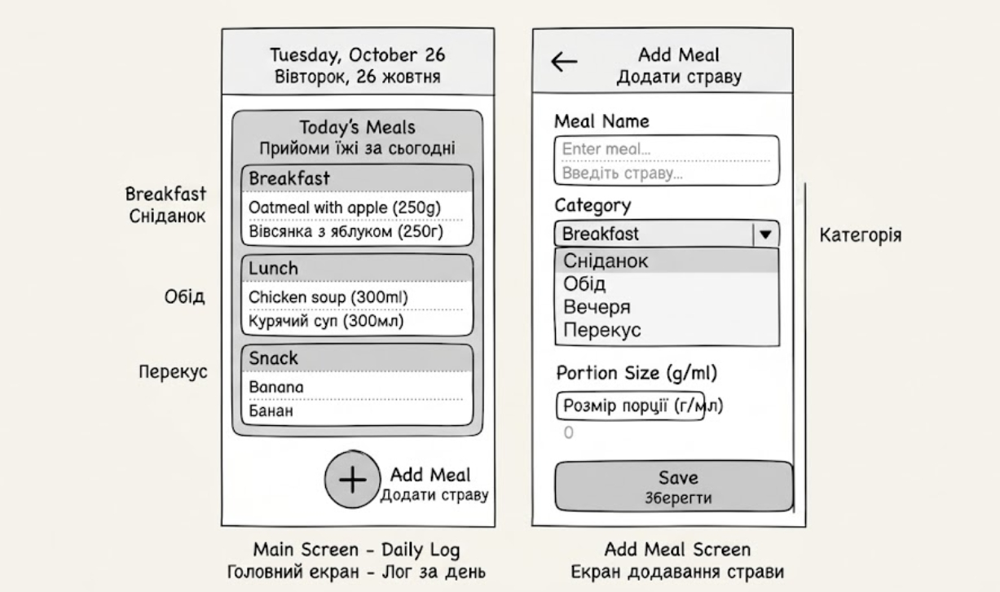

# Лабораторна робота №3: Software Development Life Cycle (SDLC)
**Тема:** Основи життєвого циклу програмного забезпечення  
**Варіант №24:** Щоденник харчування (запис прийомів їжі протягом дня)

---

## 1. Планування
**Мета проєкту:** Створити простий і зручний веб-додаток «Щоденник харчування», який дозволяє користувачам легко фіксувати свої прийоми їжі протягом дня для відстеження щоденного раціону.

**Основні можливості:**
- Користувач повинен мати можливість додавати записи про прийоми їжі (сніданок, обід, вечеря, перекуси).
- Користувач повинен мати возможность переглядати історію харчування за день.
- Користувач повинен мати можливість видаляти або редагувати помилкові записи.

---

## 2. Аналіз вимог (User Stories)

1. **Як користувач, я хочу додавати прийом їжі (назва страви, час та категорія), щоб вести облік свого щоденного раціону.** ✅ *(Must have)*
2. **Як користувач, я хочу бачити загальний список спожитих страв за поточний день, щоб аналізувати своє харчування.** ✅ *(Must have)*
3. Як користувач, я хочу видаляти запис про прийом їжі, якщо я припустився помилки при введенні.
4. Як користувач, я хочу вказувати приблизний розмір порції (у грамах або калоріях), щоб детальніше відстежувати енергетичну цінність.
5. Як користувач, я хочу фільтрувати записи за категоріями (наприклад, тільки «Сніданок» або тільки «Перекус»), щоб зручно оглядати окремі прийоми їжі.

---

## 3. Дизайн (Прототип)

Для додатка розроблено 2 основні екрани:
1. **Головний екран:** Містить поточну дату, загальний список доданих страв за день (згрупований по прийомах їжі) та кнопку **«+ Додати страву»**.
2. **Форма додавання прийому їжі:** Містить поля для введення назви страви, вибору типу (Сніданок / Обід / Вечеря / Перекус), розміру порції та кнопку «Зберегти».

> *Примітка: Файл прототипу збережено в репозиторії за шляхом `prototype.png`.*



---

## 4. Реалізація (Псевдокод)

Ключова функція — додавання нового прийому їжі у щоденник (`addMealRecord`):

```text
function addMealRecord(mealName, mealType, portionSize):
    if mealName is empty OR mealType is empty:
        return "Помилка: Назва страви та тип прийому їжі є обов'язковими!"
    
    if portionSize <= 0:
        return "Помилка: Розмір порції має бути більше 0"
        
    record = {
        id: generateUniqueId(),
        time: getCurrentTime(),
        name: mealName,
        type: mealType,
        portion: portionSize
    }
    
    dailyLog.push(record)
    return "Успіх: Прийом їжі успішно додано у щоденник!"
